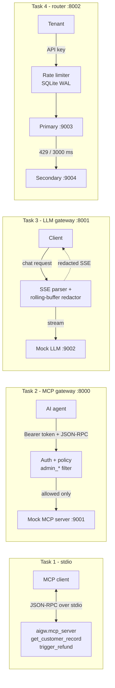

# ai-gateway-assessment

Four independent components for an AI Field Developer / Solutions Engineer assessment:
an MCP server, an MCP security gateway, a streaming PII-redacting LLM gateway, and a
rate-limiting model router with fallback. Everything runs locally against bundled mock
backends; no paid APIs are needed.

> **AI-assistance disclosure:** this project was built with the help of an AI coding assistant
> (GitHub Copilot agent mode) under my direction. I reviewed the code and test results.

## Architecture



Source layout:

```
src/aigw/
  config.py  logging_utils.py            centralized settings, stderr logging
  mcp_server/   models tools server transport __main__
  gateway/      app auth policy jsonrpc mock_downstream
  llm_gateway/  app sse redactor transform mock_provider
  router/       app limiter fallback errors mock_provider
tests/          pytest suite (unit, integration, subprocess, e2e)
```

## Setup

Requires Python 3.11+.

```bash
python3.12 -m venv .venv && source .venv/bin/activate
pip install -e ".[dev]"
```

The `mcp` dependency is pinned to `>=1.12,<2` (the v1 SDK API).

## Task 1: MCP server

```bash
aigw-mcp-server            # or: python -m aigw.mcp_server
```

Tools: `get_customer_record(customer_id)` and `trigger_refund(customer_id, amount, reason)`.

- `customer_id` must match `^CUST-[0-9]{5}$`; extra/missing fields and wrong types are rejected.
- `amount` is a `Decimal`: positive, at most 2 decimal places, max 100000; strings, bools,
  NaN and infinity are rejected. `reason` needs at least 10 characters including 5 word characters.
- Invalid arguments return JSON-RPC `-32602`; unknown methods `-32601`; unexpected faults
  `-32603`. Business failures (unknown customer, refund above lifetime spend) are tool results
  with `isError: true`, not protocol errors.
- stdout carries only JSON-RPC. `__main__` takes the real stdout for the transport and
  rebinds `sys.stdout` to stderr so a stray `print` cannot corrupt the stream.

```bash
printf '%s\n' \
 '{"jsonrpc":"2.0","id":1,"method":"initialize","params":{"protocolVersion":"2025-03-26","capabilities":{},"clientInfo":{"name":"cli","version":"1"}}}' \
 '{"jsonrpc":"2.0","method":"notifications/initialized"}' \
 '{"jsonrpc":"2.0","id":2,"method":"tools/call","params":{"name":"get_customer_record","arguments":{"customer_id":"CUST-12345"}}}' \
 | (cat; sleep 1) | aigw-mcp-server 2>/dev/null
```

## Task 2: MCP security gateway

```bash
uvicorn aigw.gateway.mock_downstream:app --port 9001 &
AIGW_GATEWAY_TOKENS='{"admin-token":"admin","viewer-token":"viewer"}' \
  uvicorn aigw.gateway.app:build_app_from_env --factory --port 8000
```

```bash
curl -s localhost:8000/mcp -H 'Authorization: Bearer viewer-token' -H 'Content-Type: application/json' \
  -d '{"jsonrpc":"2.0","id":1,"method":"tools/call","params":{"name":"admin_reset_key","arguments":{}}}'
# {"jsonrpc":"2.0","id":1,"error":{"code":-32001,"message":"Unauthorized Tool Call"}}
```

- Roles come from a server-side token map (`AIGW_GATEWAY_TOKENS`), compared in constant time.
  The token's role is never read from the client. Missing/invalid tokens get HTTP 401 and `-32002`
  before the body is parsed.
- `tools/list` is forwarded transparently. `tools/call` names are NFKC-normalized, trimmed and
  casefolded before the `admin_` check, so `Admin_x` and look-alike forms are blocked for viewers.
- Blocked requests never reach the downstream server (tests assert zero upstream requests).
  Request IDs are preserved; blocked notifications are dropped (HTTP 202); batches are
  evaluated per item (max 50); the parsed body is re-serialized to defeat duplicate-key tricks.
- Downstream failure gives `-32003` / HTTP 502 with no internal details. The `Authorization`
  header is never forwarded.

## Task 3: Streaming LLM gateway with PII redaction

```bash
uvicorn aigw.llm_gateway.mock_provider:app --port 9002 &
AIGW_LLM_PROVIDER_URL=http://127.0.0.1:9002/v1/chat/completions \
  uvicorn aigw.llm_gateway.app:build_app_from_env --factory --port 8001
```

```bash
curl -N localhost:8001/v1/chat/completions -H 'Content-Type: application/json' \
  -d '{"model":"mock","messages":[{"role":"user","content":"mail bob@example.com ssn 123-45-6789"}],"mock":{"delta_size":3,"delay_ms":50}}'
```

The mock echoes the prompt in tiny deltas, so the email and SSN are split across many frames;
the output contains `[REDACTED]` instead.

How it works:

1. Upstream bytes are fed to an incremental SSE parser (split UTF-8 and frames across chunks are
   handled; malformed frames are dropped).
2. Each `delta.content` goes through a `StreamRedactor`. It emits text only up to a *safe cut*:
   a point next to a character that cannot be part of any PII pattern. Only the trailing
   partial token is held back, so TTFT is essentially unchanged and memory is bounded
   (hard cap `MAX_MATCH_LENGTH = 450` characters). Streaming output equals redacting the whole
   text at once (property-tested).
3. Held text is flushed before `finish_reason` / `[DONE]`. On upstream failure the held text is
   flushed and a generic `event: error` is sent. The upstream connection is closed on client
   disconnect or cancellation.

Detected: emails, SSNs (`123-45-6789`, spaces or dashes), credit cards (grouped formats, and
13–19 contiguous digits that pass Luhn).

## Task 4: Rate limiter and model fallback

```bash
uvicorn aigw.router.mock_provider:primary_app --port 9003 &
uvicorn aigw.router.mock_provider:secondary_app --port 9004 &
AIGW_RATE_LIMIT_DB=./rate_limits.db uvicorn aigw.router.app:build_app_from_env --factory --port 8002
```

```bash
curl -s localhost:8002/v1/completions -H 'Authorization: Bearer my-tenant-key' \
  -H 'Content-Type: application/json' -d '{"prompt":"hello","max_tokens":100}'
# force a fallback: primary answers 429
curl -s localhost:8002/v1/completions -H 'Authorization: Bearer my-tenant-key' \
  -H 'Content-Type: application/json' \
  -d '{"prompt":"hi","mock":{"primary":{"status":429}}}'
```

**Rate limiter** (`router/limiter.py`): 50,000 tokens per rolling 60 s per tenant.

- On-disk SQLite in WAL mode; table `token_reservations(id, tenant, tokens, reserved_at)` with
  indexes on `(tenant, reserved_at)` and `reserved_at`. Tenants are stored as SHA-256 hashes.
- Each reservation is a `BEGIN IMMEDIATE` transaction that purges the tenant's expired rows,
  sums the window, and inserts only if it fits, so it is atomic across threads and processes.
- The estimate (`ceil(len(prompt)/4) + max_tokens`) is reserved up front, then replaced by the
  provider's actual usage, or released fully if the request fails or the client cancels.
- Lock contention is retried briefly (`busy_timeout` plus a bounded retry loop); persistent
  failure surfaces as `503 rate_limiter_unavailable`. State survives restarts. A crash between
  reserve and settle leaves the estimate counted until it expires (fails closed).
- A 429 carries `Retry-After` computed from when enough old reservations expire. A single request
  larger than the limit gets 429 with no `Retry-After` since it can never fit.

**Fallback** (`router/fallback.py`): the primary gets one attempt bounded by a 3000 ms deadline
(`asyncio.timeout` cancels the in-flight request). HTTP 429 or timeout triggers exactly one
secondary attempt (10 s deadline). Other primary failures (5xx, connection errors) are not
retried on the secondary. No loops, so no duplicate calls.

**Errors** are always `{"error": {"type","code","message","request_id"}}` with generic messages:
`invalid_api_key` 401, `invalid_request` 400, `rate_limit_exceeded` 429,
`upstream_rate_limited` 429, `upstream_timeout` 504, `upstream_unavailable` 502,
`rate_limiter_unavailable` 503, `internal_error` 500. No stack traces, URLs or keys.

## Tests

```bash
pytest -q          # full suite
ruff check . && ruff format --check .
```

Suites cover MCP models/integration/stdio subprocess (including stdout isolation with a
deliberately noisy launcher), gateway authorization, redactor/SSE/transform and streaming
behavior (chunk boundaries, large streams, cancellation, bounded buffers), limiter
(boundaries, expiry with a fake clock, concurrency, restart persistence, locked/corrupt DB),
router fallback and sanitization, and end-to-end tests over real sockets. CI runs them on
Python 3.11–3.13.

## Security considerations

- API keys and tokens are never logged or returned; the limiter stores hashes only.
- Authorization is decided server-side and before payload parsing; limits on body size and batch size.
- Error payloads are generic and carry a request ID for log correlation.
- The `mock` request field is forwarded to providers for local fault injection only. Remove it
  from `CompletionRequest` (and the Task 3 gateway) before pointing at real providers.
- The router accepts any non-empty key unless `valid_keys` is passed to `create_app`; wire it to
  a real key store for production.

## Limitations

- MCP SDK behavior: malformed JSON on stdin yields a log notification, not a `-32700` response;
  closing stdin early can drop in-flight responses.
- Task 2 supports JSON responses from the downstream, not SSE streams.
- Redaction: PII still incomplete at end of stream is not redacted; contiguous 9-digit SSNs,
  non-ASCII digits and deliberately obfuscated values (`a t example dot com`) are missed;
  SSNs are not range-validated and grouped card numbers are redacted without a Luhn check
  (favoring over-redaction); only `delta.content`/`text` are inspected (not tool-call
  arguments); non-streaming requests are unsupported. Held text costs at most one word of delay.
- Token counts are estimates (4 chars/token); cross-host limiting needs a shared database, as
  SQLite files do not work reliably over network filesystems.
- Rate limiting happens per request admission; a failed settle leaves the estimate counted.

## Interview demo script

1. **MCP server:** run the printf pipeline above, then `pytest tests/test_mcp_stdio.py -q` to show
   stdout isolation and error codes.
2. **MCP gateway:** start the mock downstream and gateway, send the viewer/admin curls, then
   `pytest tests/test_gateway.py -q` (look for the zero-upstream-request assertions).
3. **Streaming guardrail:** run the Task 3 curl with `-N` and watch `[REDACTED]` appear;
   `pytest tests/test_redactor.py tests/test_llm_gateway.py -q`.
4. **Router:** run both curls; hammer one key until 429 with `Retry-After`; restart the gateway
   and show usage persists; `pytest tests/test_limiter.py tests/test_router.py -q`.
